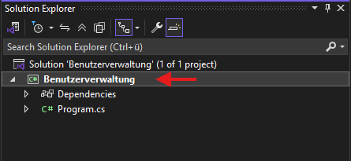
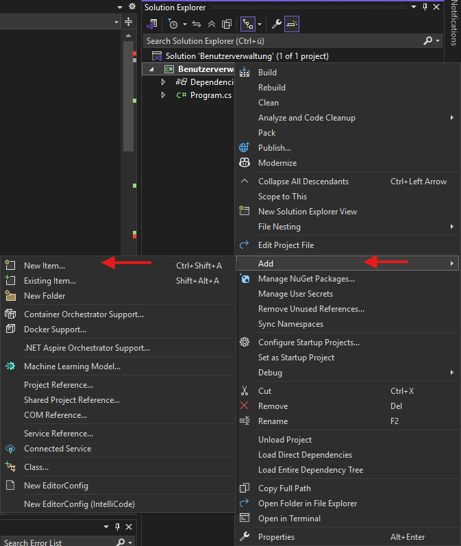

# Klasses und Objekte (Einführung zu Objektorientierter Programmierung)

## Eine Klasse erstellen

1. Rechtsklick auf das Projekt (Beispiel: **Benutzerverwaltung**)



2. **Hinzufügen**
3. **Neues Element**



4. **Klasse** auswählen
5. Namen eingeben (z.B. `User`)
6. Auf **Hinzufügen** klicken

Visual Studio erstellt nun automatisch eine neue Datei namens `User.cs`.

---

## Beispiel einer Klasse

Eine Klasse ist ein Entwurf. Jedes Objekt wird auf Grundlage von diesem Entwurf gebaut. \
Beispielklasse: 
```
class Hund
{
    public string Name { get; set; }
    public int Alter { get; set;}

    public Dog(string name, int alter) //Konstruktor
    {
        Name = name;
        Alter = alter;
    }

    public void Bellen()
    {
        Console.WriteLine($"{Name} sagt: Wuff!");
    }
}

// Die Klasse nutzen:
Hund meinHund = new Hund("Rex", 3);
meinHund.Bellen();
Console.WriteLine($"{meinHund.Name} ist {meinHund.Alter} Jahre alt.");
```
Ein Objekt wird immer mit `new 'KlassenName'()` erstellt. Dabei müssen alle im Konstruktor stehenden Parameter auf einen Wert gesetzt werden. Wenn man auf bestimmte Variablen innerhalb eines Objekts zugreifen will schreibt man `ObjektName.Variable`, damit auf die richtige Variable im richtigen Objekt verwiesen wird. 
