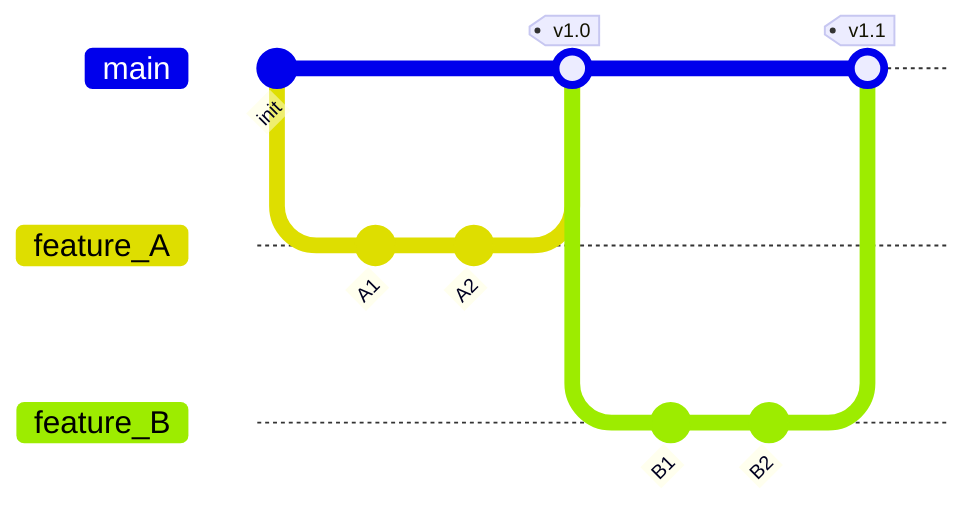

 
# Zusatzaufgabe 8 - Git Versionsverwaltung
 
| | |
|---|---|
| **Schwierigkeit** | Mittel|
| **Dauer** | ca. ??? |
| **Benötigte Kapitel** | 0 |
 
## Ziel
 
Versionsverwaltung über git kennenlernen.
 
Dabei übst du:
- Wie clone ich ein repo
- Wie erstelle ich ein branch/ pushe commits?
- Wie löse ich conflikte

---
 
## Was du dafür brauchst
 
**Repo clonen**
 
```shell
git clone https://INIT-BT@dev.azure.com/INIT-BT/Trainee-Lab/_git/trainee.bogy
```
 
damit kannst du das projekt herunterladen.
 
---
 
## Aufgaben
 
### Stufe 1: Branch erstellen
 
Ein branch ist, wie der name sagt eine abzweigung.\
Es ist wie ein isolierter Bereich in dem du code hinzufügen kannst one das original (der main branch) kaputt zu machen.



Du kannst einen branch mit einem einfachen befehl erstellen:
 
```shell
git switch -c feature/BOGY/<name>_<nachname>
```


Der Branch ist **noch nicht** auf den reposetory sichtbar!\
Du musst erst `git push` ausführen.




`switch` => Branch wechseln.\
`-c` => Neuen Branch erstellen


 

### Stufe 2: Commit
 
Jedes mal wenn eine änderung fertig ist erstellt man einen commit (das sind die punkte `A1`, `A2`, ...)

Füge in zeile 10 in Programm.cs eine abfrage hinzu in der getestet wird, ob der eingegebene string aus zwei wörtern besteht.


```csharp
10  if (input.Split(' ').Length != 2)
11  	return ValidationResult.Error("[red]Please only enter [bold]Name[/] and [bold]Surname[/][/]");
```



Führe jetzt den befehl `git status` aus und gucke dir die ausgabe an.\
Es sollte ungefähr so aussehen:
```text
On branch feature/BOGY/<name>_<nachname>
Your branch is up to date with 'origin/feature/BOGY/<name>_<nachname>'.

Changes not staged for commit:
  (use "git add <file>..." to update what will be committed)
  (use "git restore <file>..." to discard changes in working directory)
        modified:   Program.cs

no changes added to commit (use "git add" and/or "git commit -a")
```

Das beseutet: Die änderungen wurden erkannt aber noch nicht hinzugefügt.

Um ein commit zu erstellen müssen wir erst entcheiden welche änderungen dort rein kommen sollen.\
Dafür benutzt man `git add`.\
Damit stellt man seine änderungen so zu sagen auf die bühne (stage).\

führe den befehl `git add <Datei>` aus um deine änderungen zu stagen (auf die bühne stellen) und führe danach nochmal git status aus.
Jetzt sollte es so aussehen:
```text
On branch feature/BOGY/<name>_<nachname>
Your branch is up to date with 'origin/feature/BOGY/<name>_<nachname>'.

Changes to be committed:
  (use "git restore --staged <file>..." to unstage)
        modified:   Program.cs
```

Jetzt kannst du den commit erstellen.


Der commit braucht immer eine zur änderung passenden commit-Nachricht!



Führe dafür diesen befehl aus:
```shell
git commit -m "<Deine commit-Nachricht>"
```

Jetzt kannst du deinen kommit an das repo schcken mit `git push`.

Führe nun folgenden befehl aus, guck dir die ausgabe an und versuche sie zu verstehen:
```shell
git log --oneline --graph
```

### Stufe 3: Switch
 
Du kannst mit einem leeren staging-bereich jeder zeit deinen branch ändern.

Bei dem letzten befehl hast du den forherigen branch gesehen.\
Wechle mit `git switch <branch-name>` auf diesen branch.


[Tipp]



### Stufe 4: [Titel]
 
[Beschreibung]
 

[Tipp]


 
---
 
## Typische Fehler
 
| Fehler | Was passiert | Lösung |
|---|---|---|
| [Fehler] | [Folge] | [Lösung] |
| [Fehler] | [Folge] | [Lösung] |
 
---
 
## Extras
 
1. [Extra]
2. [Extra]
3. [Extra]
---
 
## Checkliste
 
- [ ] [Punkt]
- [ ] [Punkt]
- [ ] [Punkt]
---
 
[← [Vorherige Aufgabe]]([Datei].md) · [Übersicht](index.md)
 
